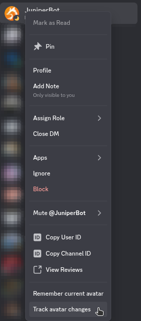
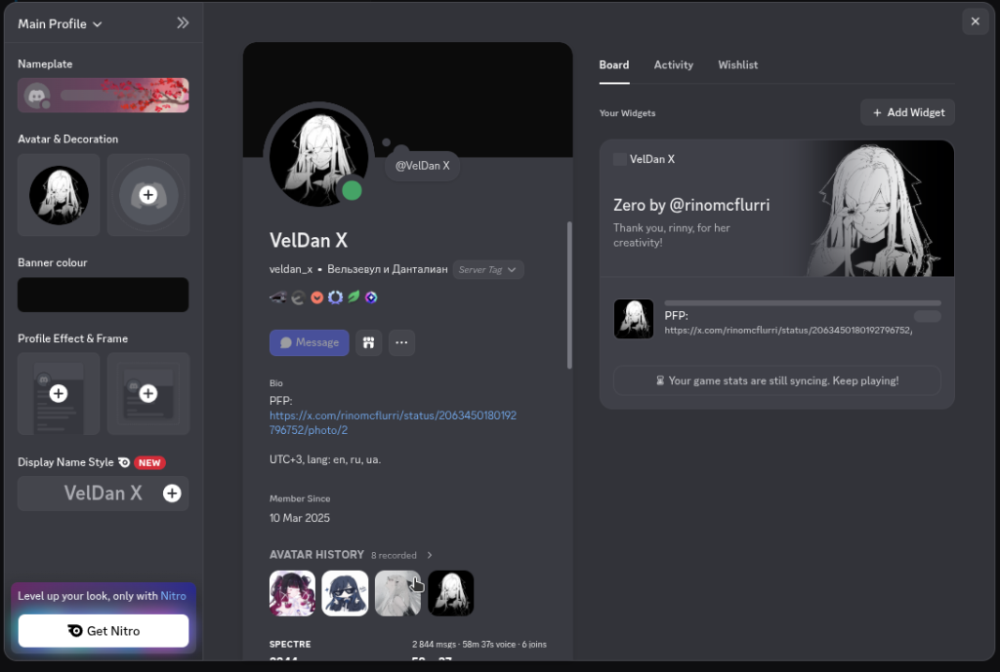
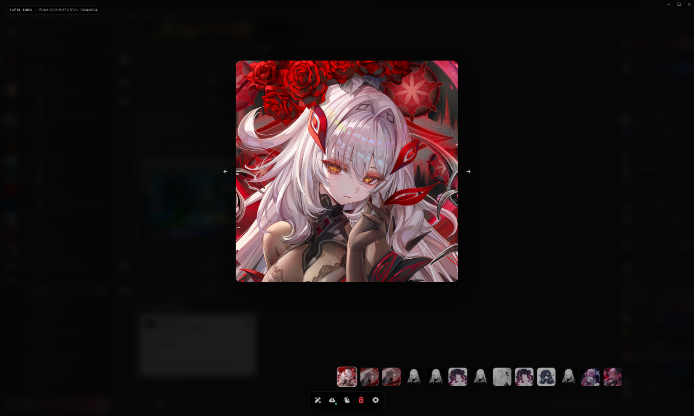
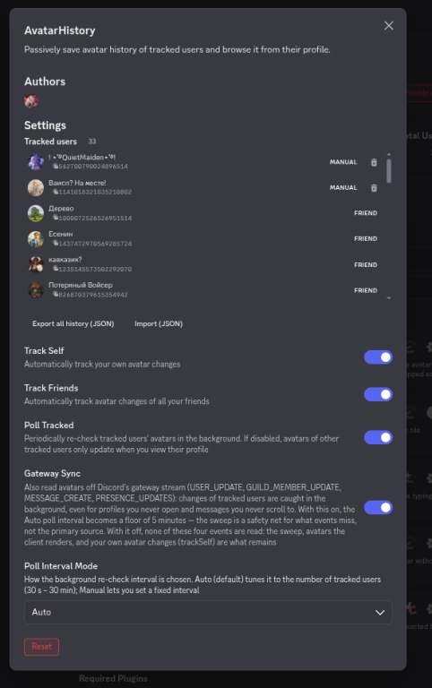

# AvatarHistory

Vencord / Equicord userplugin that passively records avatar changes and lets you browse the history right from the user profile.

> **Client-side only.** Everything runs inside your running Discord client — there is no server component, no bot and no external service. While the client is closed or offline, the plugin does not run at all: no events, no sweeps, nothing recorded.
>
> What that costs you: after time away, **your own** history is restored in full (Discord keeps your old avatars server-side), and for **other users** only the avatar that is current *now* is discovered — intermediate changes are gone for good, because Discord exposes no avatar history for anyone but yourself. On the next launch the background sweep starts with whoever has gone longest unconfirmed, so the users most likely to have changed are checked first.

[](https://docs.vencord.dev/plugins) [](https://docs.equicord.org/plugins) [](https://www.typescriptlang.org) [](LICENSE) [](https://github.com/VelDanX/AvatarHistory/releases/tag/0.0.5) [](https://github.com/VelDanX/AvatarHistory) [](https://codeberg.org/VelDanX/AvatarHistory)

**English** · [Русский](#русский)

## Features

- Tracks your own avatar changes (toggle in settings)
- Track any user via right-click → "Track avatar changes"
- Optionally auto-track all your friends (toggle in settings)
- Background tracking: avatars of tracked users are re-checked periodically
- Settings show a live overview of tracked users (count + list, badges for friends/manual/you)
- Polite to the API: background checks are paced, capped per interval and back off automatically on rate limits
- Instant capture: any rendered avatar of a tracked user (member list, DMs, messages...) is recorded on the spot
- Guild member data is a source too: a tracked user's new avatar is recorded from member updates and member-list chunks, even before it is rendered — no extra API calls
- Syncs the whole list of your own previous avatars that Discord keeps server-side (`/users/@me/avatars`) — at startup or on demand from the context menu
- Profile section with a 4-avatar preview; click opens the fullscreen viewer
- Lightbox: navigate, download, copy URL, delete, "remember current avatar", and set one of your saved avatars as your profile picture (toolbar button or image right-click menu; animated ones need Nitro)
- Local copies (blobs, ≤ 10 MB each) are saved the moment an avatar is seen and stay viewable without a network connection, even after the CDN drops it; older entries without a copy are repaired when you open the profile
- Export / import history as JSON (image data is embedded for entries that have a local copy)
- Auto-purge of your own records that no longer resolve on the CDN (at startup and on manual sync)

## Preview

**Right-click a user** — the plugin adds "Remember current avatar" (save the current avatar into the history) and "Track avatar changes" (start tracking this user's avatar changes):



**Profile section** — the user profile modal shows an "Avatar history" section (with an "N recorded" counter) and a preview of the last 4 avatars; clicking any preview opens the fullscreen gallery:



**Lightbox** — fullscreen viewer over the whole history: large preview, a "1 of N" counter, the record timestamp (UTC plus your local offset) and the image size on top, an action bar at the bottom (set as profile avatar, download, copy URL, delete, "More" menu), and a rail of all saved avatars below:



## Settings

| Setting | Default | Description |
| ------- | ------- | ----------- |
| trackedOverview | — | Live overview of tracked users: count, list with source badges, copyable user IDs, per-user remove buttons |
| trackSelf | ✔ | Track your own avatar changes |
| trackFriends | ✘ | Auto-track avatar changes of all your friends |
| pollTracked | ✔ | Periodically re-check tracked users' avatars in the background. If disabled, avatars of other tracked users only update when you view their profile |
| gatewaySync | ✔ | Also read avatars off Discord's gateway stream (`USER_UPDATE`, `GUILD_MEMBER_UPDATE`, `MESSAGE_CREATE`, `PRESENCE_UPDATE`): changes of tracked users are caught in the background, even for profiles you never open and messages you never scroll to. With this on, the Auto poll interval becomes a floor of 5 minutes — the sweep is a safety net for what events miss, not the primary source |
| pollIntervalMode | Auto | Interval mode: **Auto** tunes the re-check interval to the number of tracked users (30 s – 30 min, or 5 min – 30 min with gatewaySync on); **Manual** shows a seconds input pre-filled with the interval Auto currently picks |
| pollIntervalSeconds | 30 s (Manual only) | Fixed re-check interval in seconds — only shown when the mode is set to Manual. Auto never overwrites it; it is yours |

The settings screen — toggles for tracking, a live overview of tracked users (avatars, names, source badges, copyable user IDs, per-user remove buttons) and the poll interval mode:



## Installation

Same steps for Vencord and Equicord — for Equicord, the plugin also goes into `src/userplugins/`.

> **Warning:** requires the developer build — production builds ship without userplugins.
>
> - Vencord (developer build): <https://docs.vencord.dev/installing/>
> - Equicord (developer build): <https://docs.equicord.org/plugins>

### Option 1: Clone

```
git clone https://github.com/VelDanX/AvatarHistory src/userplugins/avatarHistory
```

or via Codeberg:

```
git clone https://codeberg.org/VelDanX/AvatarHistory src/userplugins/avatarHistory
```

Then follow the [official Vencord custom plugins guide](https://docs.vencord.dev/plugins/developers/)
(`pnpm install && pnpm build`). The plugin is auto-discovered, no extra config needed.

### Option 2: Manual download

1. Download the ZIP from [GitHub](https://github.com/VelDanX/AvatarHistory) or [Codeberg](https://codeberg.org/VelDanX/AvatarHistory).
2. Unzip into `src/userplugins/` so the plugin ends up as `src/userplugins/avatarHistory` (a trailing `-main` suffix is fine).
3. Run `pnpm install && pnpm build` in the repo root.

## Mirrors

- GitHub: <https://github.com/VelDanX/AvatarHistory>
- Codeberg: <https://codeberg.org/VelDanX/AvatarHistory>

## Data storage

All data stays local (IndexedDB via Vencord's DataStore). Nothing is synced to the cloud.

| Key | Content |
| --- | ------- |
| `vc-avh-history` | Per-user entry: the avatar records (hash, timestamp, format, dimensions) plus `lastSeenAt` — when this user's current avatar was last confirmed. That watermark is what orders the background sweep |
| `vc-avh-tracked` | Manually tracked user IDs |
| `vc-avh-blob:<userId>:<hash>` | Local image copy as a Blob (≤ 10 MB per copy) |

Older stores are migrated on first start (the flat record map and the intermediate `{version, users}` shape are both accepted), then rewritten once in the current format.

## License

GPL-3.0-or-later — see `LICENSE`.

## Project structure

```
avatarHistory/
├── index.tsx                       # Entry point: definePlugin, context menus, flux hooks, start/stop
├── src/
│   ├── config.ts                   # Constants: copy budget, CDN timeout, intervals, CDN-URL marker
│   ├── services.ts                 # Start/stop of the background machinery (sniffer, sweep, store load)
│   ├── tracking.ts                 # The "should we track this user" decision and recording their avatar
│   ├── poll.ts                     # Sweep targets + Auto interval math (pure: no settings writes)
│   ├── contextMenu.tsx             # Menu items: remember avatar, track, sync, reset history
│   ├── settings.tsx                # definePluginSettings + interval-setting migration
│   ├── cdnUrl.ts                   # CDN avatar URL builder (regular and archived)
│   ├── style.css                   # Plugin styles
│   │
│   ├── store/                      # Data; import only from store/index
│   │   ├── index.ts                # Barrel: re-exports storage, the plugin's single import point
│   │   ├── types.ts                # DataStore keys and types (AvatarRecord, UserHistory, sameHash)
│   │   ├── history.ts              # History + lastSeenAt, store migration, tracked users, subscriptions, hooks
│   │   ├── blobs.ts                # Local copies: download, object URL, data URL, 10 MB limit per copy
│   │   └── transfer.ts             # History export / import to JSON
│   │
│   ├── sync/                       # Syncing with Discord and the CDN
│   │   ├── sniffer.ts              # Interception of rendered avatars (resource timing + )
│   │   ├── recentSync.ts           # Your own past avatars from the server (/users/@me/avatars) + manual sync
│   │   ├── gateway.ts              # Avatars off the client's own gateway stream (FluxDispatcher, no socket of our own)
│   │   ├── bgSync.ts               # Background re-check: intervals, stagger, backoff on 429 (queue by staleness)
│   │   └── cdn.ts                  # HEAD check of an avatar on the CDN and cleanup of dead records (your own by default)
│   │
│   └── ui/                         # Interface
│       ├── ProfileSection.tsx      # "Avatar history" section with thumbnails in the profile
│       ├── TrackedUsersOverview.tsx# Live list of tracked users in settings
│       ├── useAvatarImage.ts       # Shared  source: CDN guess → off-screen probe → blob → dated placeholder
│       ├── avatarPlaceholder.ts    # Dated SVG shown when every source for a record is dead
│       └── lightbox/
│           ├── Lightbox.tsx        # Fullscreen viewer + openAvatarLightbox()
│           ├── useLightboxState.ts # State hook: index, records, keys and zone clicks
│           ├── LightboxToolbar.tsx # Action bar under the viewer
│           ├── AvatarRail.tsx      # Rail of all saved avatars
│           ├── ConfirmBar.tsx      # Inline confirmation of dangerous actions
│           ├── IconButton.tsx      # Icon button
│           ├── actions.ts          # Download, apply avatar, export/import
│           ├── gearMenu.tsx        # Gear menu: tracking, export/import, history reset
│           └── imageMenu.tsx       # Right-click menu on the image inside the lightbox
│
├── docs/screenshots/               # Screenshots for the README
└── LICENSE
```

Data flow: `index.tsx` → `services.ts` starts `sync/` and `tracking.ts`; those write into
`store/`, and `ui/` reads from there through `store/index.ts` (the `useHistory` / `useTrackedUsers`
hooks). Direct imports from individual `store/` files elsewhere are forbidden — that way a storage
refactor cannot break the rest of the plugin.

---

## Русский

<a name="русский"></a>
Плагин для Vencord / Equicord: пассивно записывает смены аватаров и показывает историю прямо в профиле пользователя.

> **Только на стороне клиента.** Всё работает внутри запущенного клиента Discord — серверной части, бота и внешних сервисов нет. Пока клиент закрыт или не в сети, плагин не работает вообще: ни событий, ни фоновых проверок, ничего не записывается.
>
> Чем это приходится платить: после отсутствия **своя** история восстанавливается полностью (Discord хранит ваши старые аватары на своей стороне), а по **другим юзерам** обнаруживается только тот аватар, который актуален *сейчас*, — промежуточные смены теряются навсегда, потому что Discord не отдаёт историю аватаров никому, кроме вас. При следующем запуске фоновая проверка начинает с тех, кого дольше всего не перепроверяли, так что в первую очередь проверяются те, кто вероятнее всего изменился.

## Возможности

- Автоотслеживание смены своего аватара (тогл в настройках)
- Отслеживание любого пользователя через ПКМ → «Track avatar changes»
- Опциональное автоотслеживание всех друзей (тогл «Track friends»)
- Фоновое отслеживание: аватарки отслеживаемых юзеров периодически перепроверяются
- В настройках — живой обзор отслеживаемых (количество + список, бейджи «друг»/«вручную»/«вы»)
- Бережно к API: фоновые проверки идут с паузами, ограничены за интервал и сами отступают при рейт-лимитах
- Мгновенный захват: любая отрисованная аватарка отслеживаемого юзера (список участников, DM, сообщения...) попадает в историю сразу
- Данные участников сервера — тоже источник: новый аватар отслеживаемого юзера фиксируется из обновлений участников и чанков списка участников, ещё до отрисовки — без дополнительных запросов к API
- Синхронизация всего списка своих прошлых аватаров, которые хранит сервер Discord (`/users/@me/avatars`) — при старте или по запросу из контекстного меню
- Секция в профиле с превью 4 аватаров; клик открывает полноэкранный просмотр
- Лайтбокс: листание, скачивание, копия URL, удаление, «запомнить текущий аватар» и установка любого сохранённого своего аватара как аватар профиля (кнопка на панели или ПКМ по картинке; для анимированных нужен Nitro)
- Локальные копии (blobs, ≤ 10 МБ каждый) сохраняются в момент, когда аватар увиден, и остаются доступными без подключения к сети даже после удаления аватара с CDN; старые записи без копии докачиваются при открытии профиля
- Экспорт / импорт истории в JSON (данные картинок встраиваются для записей, у которых есть локальная копия)
- Автоочистка собственных записей, которых больше нет на CDN (при старте и при ручном синке)

## Превью

**Клик правой кнопкой по пользователю** — плагин добавляет пункты «Remember current avatar» (сохранить текущий аватар в историю) и «Track avatar changes» (начать отслеживать смены аватара):


**Секция в профиле** — в модалке профиля отображается секция «Avatar history» со счётчиком «N recorded» и превью последних 4 аватаров; клик по любому превью открывает полноэкранную галерею:


**Галерея (лайтбокс)** — полноэкранный просмотр всей истории: крупный аватар, счётчик «1 of N», дата записи (UTC + локальный часовой пояс) и размер картинки сверху, панель действий снизу (поставить как аватар профиля для своей истории, скачивание, копия URL, удаление, меню «More») и лента всех сохранённых аватаров:


## Настройки

| Настройка | По умолчанию | Описание |
| --------- | ------------ | -------- |
| trackedOverview | — | Живой обзор отслеживаемых: количество, список с бейджами источника, копируемые UserID, кнопки удаления каждого пользователя |
| trackSelf | ✔ | Отслеживать свой аватар |
| trackFriends | ✘ | Автоотслеживание аватаров всех друзей |
| pollTracked | ✔ | Периодически перепроверять аватарки отслеживаемых в фоне. Если выключено — аватарки других отслеживаемых обновляются только при просмотре их профиля |
| gatewaySync | ✔ | Дополнительно читать аватарки из гейтвей-потока Discord (`USER_UPDATE`, `GUILD_MEMBER_UPDATE`, `MESSAGE_CREATE`, `PRESENCE_UPDATE`): смены аватарок отслеживаемых ловятся в фоне, даже для профилей, которые ты не открывал, и сообщений, до которых не прокрутил. С включённой настройкой автоинтервал получает флор в 5 минут — свип становится страховкой на то, что события пропустили, а не основным источником |
| pollIntervalMode | Auto | Режим интервала: **Auto** подстраивает интервал перепроверки под число отслеживаемых (30 с – 30 мин, а с gatewaySync — 5 мин – 30 мин); **Manual** показывает поле ввода секунд, подставленное с тем интервалом, который Auto выбирает сейчас |
| pollIntervalSeconds | 30 с (только Manual) | Фиксированный интервал перепроверки в секундах — показывается только в режиме Manual. Auto его не перезаписывает, это ваше значение |

Экран настроек — тоглы отслеживания, живой обзор отслеживаемых (аватары, имена, бейджи источника, копируемые UserID, кнопки удаления каждого пользователя) и режим интервала проверки:


## Установка

Шаги одинаковы для Vencord и Equicord — в Equicord плагин также кладётся в `src/userplugins/`.

> **Внимание:** нужна developer-сборка — в production-сборках плагинов нет.
>
> - Vencord (developer-сборка): <https://docs.vencord.dev/installing/>
> - Equicord (developer-сборка): <https://docs.equicord.org/plugins>

### Вариант 1: Клонирование

```
git clone https://github.com/VelDanX/AvatarHistory src/userplugins/avatarHistory
```

или через Codeberg:

```
git clone https://codeberg.org/VelDanX/AvatarHistory src/userplugins/avatarHistory
```

Затем следуйте [официальному гайду по плагинам Vencord](https://docs.vencord.dev/plugins/developers/)
(`pnpm install && pnpm build`). Плагин подхватывается автоматически.

### Вариант 2: Скачать вручную

1. Скачайте ZIP с [GitHub](https://github.com/VelDanX/AvatarHistory) или [Codeberg](https://codeberg.org/VelDanX/AvatarHistory).
2. Распакуйте в `src/userplugins/`, чтобы получилось `src/userplugins/avatarHistory` (суффикс `-main` тоже подходит).
3. Запустите `pnpm install && pnpm build` в корне репозитория.

## Зеркала

- GitHub: <https://github.com/VelDanX/AvatarHistory>
- Codeberg: <https://codeberg.org/VelDanX/AvatarHistory>

## Где хранятся данные

Все данные хранятся локально (IndexedDB через DataStore Vencord). В облако ничего не синхронизируется.

| Ключ | Содержимое |
| ---- | ---------- |
| `vc-avh-history` | Запись пользователя: список аватаров (hash, timestamp, формат, размеры) плюс `lastSeenAt` — когда последний раз подтверждался текущий аватар этого юзера. Именно по этому знаку строится очередь фоновой проверки |
| `vc-avh-tracked` | Вручную отслеживаемые ID |
| `vc-avh-blob:<userId>:<hash>` | Локальная копия изображения как Blob (≤ 10 МБ на копию) |

Старые хранилища мигрируются при первом запуске (принимаются и плоская карта записей, и промежуточная форма `{version, users}`), после чего один раз переписываются в актуальном формате.

## Лицензия

GPL-3.0-or-later — см. `LICENSE`.

---

## Структура проекта

```
avatarHistory/
├── index.tsx                       # Точка входа: definePlugin, контекстные меню, flux-хукеры, start/stop
├── src/
│   ├── config.ts                   # Константы: бюджет копии, таймаут CDN, интервалы, маркер CDN-URL
│   ├── services.ts                 # Старт/стоп фоновой машинерии (снайфер, опрос, загрузка стора)
│   ├── tracking.ts                 # Решение «отслеживать ли пользователя» и запись его аватаров
│   ├── poll.ts                     # Цели свипа и математика авто-интервала (чисто: без записи в настройки)
│   ├── contextMenu.tsx             # Пункты меню: запомнить аватар, трекинг, синк, сброс истории
│   ├── settings.tsx                # definePluginSettings + миграция настройки интервала
│   ├── cdnUrl.ts                   # Сборка URL аватара на CDN (обычный и архивный)
│   ├── style.css                   # Стили плагина
│   │
│   ├── store/                      # Данные; импортировать только из store/index
│   │   ├── index.ts                # Barrel: переэкспорт storage, единственная точка импорта для плагина
│   │   ├── types.ts                # Ключи DataStore и типы (AvatarRecord, UserHistory, sameHash)
│   │   ├── history.ts              # История + lastSeenAt, миграция хранилища, отслеживаемые, подписки, хуки
│   │   ├── blobs.ts                # Локальные копии: загрузка, object URL, data URL, лимит 10 МБ на копию
│   │   └── transfer.ts             # Экспорт / импорт истории в JSON
│   │
│   ├── sync/                       # Синхронизация с Discord и CDN
│   │   ├── sniffer.ts              # Перехват отрисованных аватаров (resource timing + )
│   │   ├── recentSync.ts           # Свои прошлые аватары с сервера (/users/@me/avatars) + ручной синк
│   │   ├── gateway.ts              # Аватарки из гейтвей-потока самого клиента (FluxDispatcher, без своего сокета)
│   │   ├── bgSync.ts               # Фоновая перепроверка: интервалы, stagger, backoff при 429 (очередь — по давности)
│   │   └── cdn.ts                  # HEAD-проверка аватара на CDN и очистка битых записей (по умолчанию у себя)
│   │
│   └── ui/                         # Интерфейс
│       ├── ProfileSection.tsx      # Секция «Avatar history» с миниатюрами в профиле
│       ├── TrackedUsersOverview.tsx# Живой список отслеживаемых в настройках
│       ├── useAvatarImage.ts       # Общий src для : догадка CDN → офскрин-проба → блоб → датированная заглушка
│       ├── avatarPlaceholder.ts    # SVG с датой записи, когда не сработал ни один источник
│       └── lightbox/
│           ├── Lightbox.tsx        # Полноэкранный просмотрщик + openAvatarLightbox()
│           ├── useLightboxState.ts # Хук состояния: индекс, записи, клавиши и клики по зонам
│           ├── LightboxToolbar.tsx # Панель действий под просмотрщиком
│           ├── AvatarRail.tsx      # Лента всех сохранённых аватаров
│           ├── ConfirmBar.tsx      # Инлайн-подтверждение опасных действий
│           ├── IconButton.tsx      # Кнопка-иконка
│           ├── actions.ts          # Скачивание, применение аватара, экспорт/импорт
│           ├── gearMenu.tsx        # Меню шестерёнки: трекинг, экспорт/импорт, очистка истории
│           └── imageMenu.tsx       # ПКМ по картинке внутри лайтбокса
│
├── docs/screenshots/               # Скриншоты для README
└── LICENSE
```

Поток данных: `index.tsx` → `services.ts` запускает `sync/` и `tracking.ts`; те пишут в
`store/`, а `ui/` читает оттуда через `store/index.ts` (хуки `useHistory` / `useTrackedUsers`).
Прямые импорты из отдельных файлов `store/` снаружи запрещены — так рефакторинг хранилища
не ломает остальной плагин.